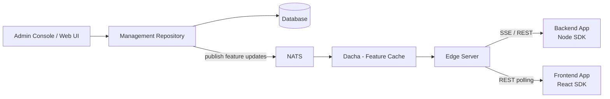

## มาลองใช้ FeatureHub เปิด-ปิด Feature แบบไม่ต้อง Deploy ใหม่กัน!

หลายคนที่ทำงานเป็นทีมน่าจะเคยเจอสถานการณ์แบบนี้อยู่บ่อย ๆ

Feature ใหม่เขียนเสร็จแล้ว Merge เข้า main แล้ว แต่ฝั่ง Business ยังไม่อยากให้ User เห็น… ทำให้เราต้องค้าง Branch ไว้ หรือรอ Deploy พร้อมวันเปิดตัว และถ้าเปิดไปแล้วเจอ Bug ก็ต้อง Revert แล้ว Deploy ใหม่อีกรอบ

ปัญหาหลักๆ ที่ผมเจอคือ:

  * **Deploy** (เอา Code ขึ้น Server) กับ **Release** (เปิดให้ User ใช้งาน) ถูกผูกติดกันเป็นเรื่องเดียว
  * อยากปิด Feature ที่มีปัญหาด่วนๆ ก็ต้องรอ Pipeline รันใหม่ทั้งหมด
  * อยากเปิด Feature ให้แค่บางกลุ่มลองใช้ก่อน ก็ทำได้ยาก

> แต่เดี๋ยวก่อน… จะดีกว่าไหม? ถ้าเราสามารถ Deploy Code ขึ้นไปก่อน แล้วค่อยกดสวิตช์เปิด-ปิด Feature ได้ทันทีโดยไม่ต้อง Deploy ใหม่

ซึ่งแนวคิดนี้มีชื่อเรียกว่า **Feature Flag** (หรือ Feature Toggle) นั่นเองครับ ✨

วันนี้ผมเพิ่งได้ลองเล่น **FeatureHub** ซึ่งเป็นเครื่องมือจัดการ Feature Flag แบบ Open source ในบทความนี้ผมจะพาลองรัน FeatureHub ด้วย Docker แล้วลองเชื่อมกับทั้ง Backend (Node.js) และ Frontend (React) กันครับ

## Feature Flag คืออะไร

พูดง่ายๆ ก็คือการครอบ Code ของ Feature ไว้ด้วย `if` ที่ค่าของมันไม่ได้ Hardcode ไว้ใน Code แต่ไปดึงมาจากระบบภายนอก

```typescript
if (featureIsEnabled("NEW_CHECKOUT")) {
  showNewCheckout();
} else {
  showOldCheckout();
}
```

เมื่อเราเปลี่ยนค่าในระบบภายนอก Application ก็จะเปลี่ยนพฤติกรรมตามทันที โดยไม่ต้อง Build หรือ Deploy ใหม่

## FeatureHub คืออะไร

> TODO: screenshot — FeatureHub homepage

FeatureHub เป็นแพลตฟอร์ม Open source สำหรับจัดการ Feature Flag, A/B testing และ Remote configuration โดยมีทั้งแบบ Self-hosted (รันผ่าน Docker / Kubernetes) และแบบ SaaS พร้อม SDK หลายภาษา เช่น Java, JavaScript, C#, Dart, Go, Python, Ruby และ Swift

### ภาพรวม Architecture



  * **Admin Console + Management Repository** — หน้าเว็บสำหรับสร้าง Portfolio, Application, Feature และจัดการสิทธิ์
  * **Edge** — Server ที่ SDK ใน Application ของเราเชื่อมต่อเข้ามาเพื่อขอค่า Feature
  * **Dacha / NATS** — Cache และระบบส่งต่อการเปลี่ยนแปลงของ Feature ไปยัง Edge

> สำหรับการลองเล่นในเครื่อง FeatureHub มี Image ชื่อ `featurehub/party-server` ที่รวมทุกอย่างไว้ใน Container เดียว (ใช้ Database H2) ไม่แนะนำให้ใช้บน Production นะครับ
> TODO: ตรวจรายละเอียดชื่อ component อีกครั้งที่ https://docs.featurehub.io/featurehub/latest/architecture.html

### SDK รับค่า Feature ยังไง?

SDK จะรับค่า Feature จาก Edge ได้ 3 แบบ

  * **SSE** — เปิด Connection ค้างไว้ เมื่อมีการเปลี่ยนค่า Server จะ Push มาให้ทันที (ค่า Default ของ Node SDK)
  * **Active REST** — Polling ตามช่วงเวลาที่กำหนด (ค่า Default ของ Browser SDK)
  * **Passive REST** — Polling เฉพาะตอนที่มีการเรียกใช้ Feature หลังจาก Cache หมดอายุ

## รัน FeatureHub ด้วย Docker

วิธีที่ง่ายที่สุดคือรัน `party-server` ด้วยคำสั่งเดียว

สำหรับ MacOS / Windows:

```bash
docker run -p 8085:8085 --user 999:999 -v $HOME/party:/db featurehub/party-server:latest
```

สำหรับ Linux:

```bash
docker run --network host --user 999:999 -p 8085:8085 -v $HOME/party:/db featurehub/party-server:latest
```

> `$HOME/party` คือ Folder ที่ใช้เก็บไฟล์ Database (H2) บนเครื่องของเรา

หรือถ้าใครชอบใช้ Docker Compose ก็สามารถใช้ตัวอย่างจาก Repository `featurehub-install` ได้เลย

```bash
curl -sL https://github.com/featurehub-io/featurehub-install/tarball/main | tar -xvz
cd docker-compose-options/all-in-one-h2
docker compose up
```

> หมายเหตุ: คำสั่ง `tar` จะแตกไฟล์ออกมาเป็น Folder ชื่อ `featurehub-io-featurehub-install-<commit>` ให้ `cd` เข้าไปก่อน (TODO: ตรวจชื่อ Folder ตอนรันจริง)

เมื่อรันเสร็จแล้ว เปิด Browser ไปที่ http://localhost:8085 จะพบหน้า Admin Console 🎉

> TODO: screenshot — FeatureHub admin console first page

## ตั้งค่าใน Admin Console

### 1. สร้าง Super Admin

ครั้งแรกที่เข้าใช้งาน ระบบจะให้เราลงทะเบียนเป็น Super Admin กรอกชื่อ, Email และ Password ให้เรียบร้อย

> TODO: screenshot — Register super admin

### 2. สร้าง Portfolio และ Application

FeatureHub จัดโครงสร้างข้อมูลเป็นลำดับขั้นดังนี้

```
Portfolio → Application → Environment → Feature
```

  1. ไปที่เมนู `Portfolios` แล้วคลิก `Create new portfolio` ตั้งชื่อ เช่น `Luckytime Lab` (TODO: ตรวจชื่อปุ่มจริง)
  2. ไปที่เมนู `Applications` แล้วคลิก `Create new application` ตั้งชื่อ เช่น `demo-app` (TODO: ตรวจชื่อปุ่มจริง)

> TODO: screenshot — Create portfolio and application

> ใน FeatureHub มี **Quick Setup Helper** ที่ช่วยพาสร้างทุกอย่างทีละขั้นได้ด้วย ใครขี้เกียจคลิกหลายหน้าลองใช้ตัวนี้ดูครับ

### 3. สร้าง Environment

ไปที่ `Applications > demo-app > Environments` (TODO: ตรวจ path เมนูจริง) แล้วเพิ่ม Environment เช่น `dev`

> TODO: screenshot — Create environment

### 4. สร้าง Feature

ไปที่เมนู `Features` คลิก `Create new feature` แล้วตั้งค่าดังนี้ (TODO: ตรวจชื่อปุ่มจริง)

  * Name: `New banner`
  * Key: `NEW_BANNER`
  * Type: `Standard flag (boolean)`

> TODO: screenshot — Create feature flag

### 5. สร้าง Service Account และ API Key

SDK ต้องใช้ API Key เพื่อเชื่อมต่อกับ Edge โดย API Key จะผูกกับ **Service Account** และ Environment

ไปที่ `Service Accounts` สร้าง Service Account ใหม่ แล้วให้สิทธิ์อ่าน Feature ใน Environment `dev` จากนั้นไปที่หน้า `API Keys` เพื่อคัดลอก Key (TODO: ตรวจ path เมนูจริง)

> TODO: screenshot — Copy API keys

API Key จะมี 2 แบบ

  * **Client Evaluated Key** — ส่งข้อมูล Targeting ทั้งหมดลงมาให้ Application ประเมินเอง เหมาะกับ Backend ที่อยู่ในสภาพแวดล้อมปลอดภัย
  * **Server Evaluated Key** — ให้ Server ประเมินค่าให้ เหมาะกับ Frontend หรือ Mobile ที่ Key อาจถูกเปิดเผยต่อ User

> หน้าตาของ Key จะประมาณนี้ `5e61fd62-d4ed-40e0-9cc1-cb3d809f6149/YDr1E4uQGA2Li54fQ0HpmSr2LMv9yHhwzxut2DRO`

## Backend: Node.js + TypeScript

### ติดตั้ง SDK

```bash
npm install featurehub-javascript-node-sdk express
```

### เขียน Code

สร้างไฟล์ `server.ts`

```typescript
import express from "express";
import { EdgeFeatureHubConfig, Readyness } from "featurehub-javascript-node-sdk";

const fhConfig = new EdgeFeatureHubConfig(
  process.env.FEATUREHUB_EDGE_URL!,
  process.env.FEATUREHUB_CLIENT_API_KEY!,
).init();

const app = express();

app.get("/health/liveness", (req, res) => {
  if (fhConfig.readyness === Readyness.Ready) {
    res.status(200).send("ok");
  } else {
    res.status(500).send("not ready");
  }
});

app.get("/", async (req, res) => {
  const fhClient = await fhConfig.newContext().build();

  if (fhClient.feature("NEW_BANNER").enabled) {
    res.send("🎉 New banner is ON");
  } else {
    res.send("Old banner");
  }
});

app.listen(3000, () => console.log("listening on http://localhost:3000"));
```

> TODO: ตรวจว่า `Readyness` export จาก `featurehub-javascript-node-sdk` โดยตรง (ใน README ใช้ `Readyness.Ready` แต่ไม่ได้แสดงบรรทัด import)

### รัน

```bash
export FEATUREHUB_EDGE_URL=http://localhost:8085/
export FEATUREHUB_CLIENT_API_KEY="<client-evaluated-api-key>"
npx tsx server.ts
```

ลองเรียก API ดู

```bash
curl http://localhost:3000/
# Old banner
```

จากนั้นกลับไปที่ Admin Console เปิด Flag `NEW_BANNER` ใน Environment `dev` แล้วกด Save

> TODO: screenshot — Toggle NEW_BANNER on

```bash
curl http://localhost:3000/
# 🎉 New banner is ON
```

เพียงเท่านี้ค่าก็เปลี่ยนทันทีโดยไม่ต้อง Restart Server เลย เพราะ Node SDK ใช้ SSE เป็นค่า Default 🚀

## Frontend: React

### ติดตั้ง SDK

```bash
npm install featurehub-react-sdk featurehub-javascript-client-sdk react
```

### ครอบ App ด้วย `<FeatureHub>`

```tsx
// main.tsx / App.tsx
import { FeatureHub } from "featurehub-react-sdk";

function AppContainer() {
  return (
    <FeatureHub url="http://localhost:8085" apiKey="<server-evaluated-api-key>">
      <App />
    </FeatureHub>
  );
}
```

### ใช้ `useFeature` Hook

```tsx
// Banner.tsx
import { useFeature } from "featurehub-react-sdk";

export function Banner() {
  const showNewBanner = useFeature("NEW_BANNER");

  return showNewBanner ? <h1>🎉 New banner</h1> : <h1>Old banner</h1>;
}
```

`useFeature` จะ Subscribe Feature Key ตอน Component mount และอัปเดตค่าให้อัตโนมัติเมื่อมีการเปลี่ยนแปลง

ลองเปิดหน้าเว็บค้างไว้ แล้วไปกดเปิด-ปิด `NEW_BANNER` ใน Admin Console รอสักครู่หน้าเว็บก็จะเปลี่ยนเองโดยไม่ต้อง Refresh

> TODO: screenshot — React app toggled live

> Browser SDK ใช้ Active REST polling เป็นค่า Default ดังนั้นหน้าเว็บจะเปลี่ยนตามรอบ Polling ไม่ใช่ทันทีแบบ Backend
> TODO: ตรวจวิธีตั้งค่า polling interval / streaming ผ่าน `<FeatureHub>` component (ใน README ของ client SDK ใช้ `fhConfig.restActive(5000)` หรือ `fhConfig.streaming()` บน `EdgeFeatureHubConfig`)

> ⚠️ **คำเตือน:** Frontend ควรใช้ **Server Evaluated Key** เท่านั้น เพราะ Key จะถูกเปิดเผยให้ User เห็นได้ใน Browser

## สรุป

  * Feature Flag ช่วยแยก **Deploy** ออกจาก **Release** ทำให้เราเปิด-ปิด Feature ได้โดยไม่ต้อง Deploy ใหม่
  * FeatureHub รันในเครื่องได้ง่ายๆ ด้วย `featurehub/party-server` แค่คำสั่งเดียว
  * Backend ใช้ `featurehub-javascript-node-sdk` (SSE) ส่วน Frontend React ใช้ `featurehub-react-sdk`

นอกจากเปิด-ปิดธรรมดาแล้ว FeatureHub ยังทำ Rollout strategy, User targeting และ A/B testing ได้อีก ไว้มีโอกาสผมจะมาลองเล่นต่อในบทความหน้า

การทำ Feature Flag ไม่ยากอย่างที่คิดเลยใช่ไหมครับ? ลองเอาไปปรับใช้กับโปรเจกต์ของตัวเองกันดูนะครับ แล้วพบกันใหม่ในบทความหน้า สวัสดีครับ! 🚀

**Ref:**

  * https://www.featurehub.io/
  * https://docs.featurehub.io/featurehub/latest/index.html
  * https://docs.featurehub.io/featurehub/latest/evaluation.html
  * https://docs.featurehub.io/featurehub/latest/installation.html
  * https://docs.featurehub.io/featurehub/latest/architecture.html
  * https://docs.featurehub.io/featurehub/latest/service-accounts.html
  * https://docs.featurehub.io/featurehub/latest/sdks.html
  * https://github.com/featurehub-io/featurehub-install
  * https://github.com/featurehub-io/featurehub-javascript-sdk
